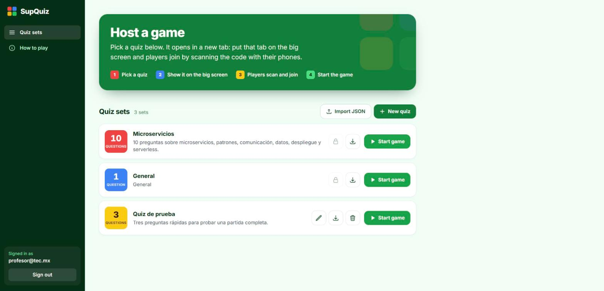
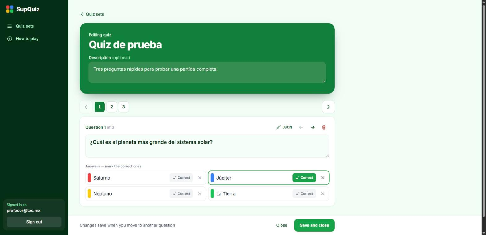
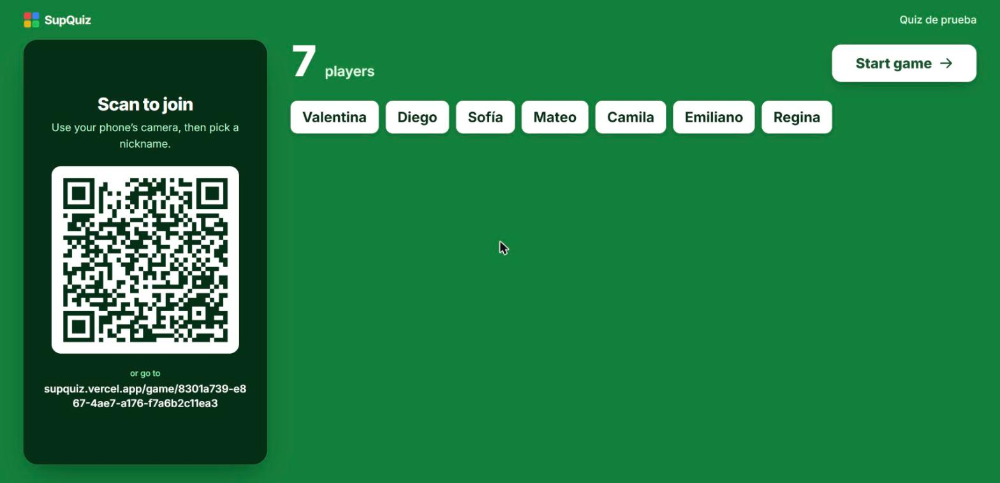
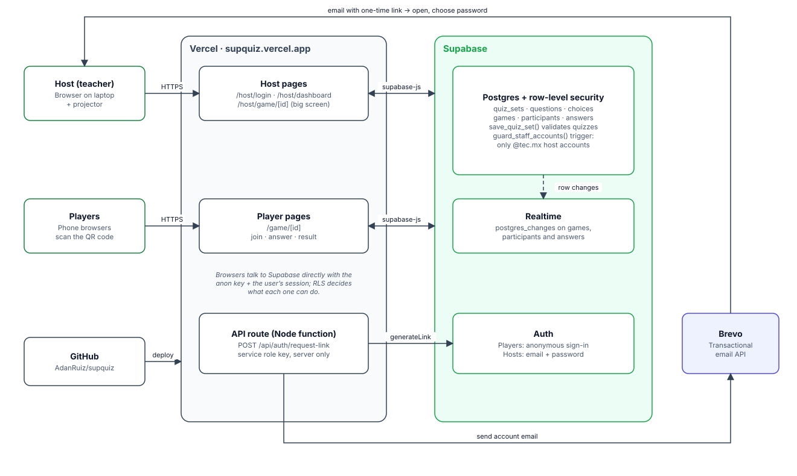

# SupQuiz

An open-source, real-time quiz game for the classroom, in the spirit of Kahoot. The host puts a game on the big screen, players join from their phones by scanning a QR code, and everyone answers against the clock.

**Live:** [supquiz.vercel.app](https://supquiz.vercel.app)



| Quiz editor | Game lobby on the big screen |
|---|---|
|  |  |

## Features

- **Live games:** questions, a countdown and answer stats on the host screen; players answer on their phones. Faster correct answers score more points.
- **Host accounts:** hosts sign in with email and password. Sign-up is limited to one email domain (`@tec.mx` by default), and new accounts are confirmed through a one-time emailed link.
- **Quiz management:** create, edit and delete quizzes from the dashboard, with 2 to 4 answers per question and one or more correct answers. The editor shows one question at a time and saves it when you move to the next one (`>`), or add a new one (`+`). The pencil button switches the question to an editable JSON view.
- **Import and export:** move quizzes in and out as JSON files ([format below](#quiz-json-format)).
- **Players need no account:** they join anonymously with a nickname, using a short game code (6 characters without look-alike letters) or the QR code.

## How a game works

1. The host signs in and clicks **Start game** on a quiz. The game opens in a new tab: put it on the big screen.
2. Players scan the QR code, or open the site and type the 6-character game code shown on the big screen (like `K7M3QX`), then pick a nickname. The short link is `/g/<code>`.
3. The host starts the game. Each question shows for 5 seconds, then the answers appear and players have 20 seconds.
4. After each question, the host sees how many picked each answer, and players see whether they got it right.
5. At the end, the host screen shows the podium and every player sees their place and score.

## Built with

- [Next.js 14](https://nextjs.org/) (App Router) and [Tailwind CSS](https://tailwindcss.com/)
- [Supabase](https://supabase.com/): Postgres, Auth, Realtime and row-level security
- [Brevo](https://www.brevo.com/) for transactional email (account links)

## Architecture



The diagram source is [`docs/architecture.drawio`](docs/architecture.drawio). The `.drawio.svg` file also opens and edits in [draw.io](https://app.diagrams.net/).

- **Vercel** serves the Next.js app. Pages render in the browser, and the only server code is one API route that sends account emails.
- **Browsers talk to Supabase directly** with `supabase-js`, using the public anon key plus the user's session. Row-level security decides what each one can do: players (anonymous) can join games and answer, and hosts (`@tec.mx` accounts) can manage quizzes and run games.
- **Realtime** pushes database changes over WebSockets: the big screen sees players join and answer, and phones follow the game as it moves between phases and questions.
- **Quizzes are saved through `save_quiz_set()`**, a Postgres function that validates the whole quiz in one transaction and keeps question and answer ids stable, so past results stay linked after edits.
- **Host accounts** are created by the API route: it asks Supabase Auth for a one-time link (with the service role key, server-side only) and sends it with Brevo. A database trigger rejects any account outside the allowed domain.
- **Deploys:** pushing to `main` on GitHub deploys to Vercel. Database changes live in `supabase/migrations` and are applied with `supabase db push`.

## Run locally

### Prerequisites

- Node.js 20 or newer
- [Docker](https://www.docker.com/) (for the local Supabase stack)
- [Supabase CLI](https://supabase.com/docs/guides/cli) (`npx supabase` works too)

### Steps

```sh
# 1. Install dependencies
npm install

# 2. Start Supabase locally (applies supabase/migrations and supabase/seed.sql)
npx supabase start

# 3. Create your env file and fill it with the keys printed by `npx supabase status`
#    (API URL, anon key, service_role key)
cp .env.example .env.local

# 4. Start the app
npm run dev
```

Open [http://localhost:3000/host/login](http://localhost:3000/host/login), choose **Create an account** and enter an `@tec.mx` address. Without Brevo configured, the account link is printed in the `npm run dev` terminal: open it, choose a password, and you're in the dashboard.

Players join at `http://<your-computer-ip>:3000` with the game code, or at `/g/<code>` (the lobby shows both the QR and the code). To join from a phone, open the host page using your computer's network IP instead of `localhost`.

## Deploy

### 1. Supabase

1. Create a project at [supabase.com](https://supabase.com/dashboard).
2. Link it and apply the migrations:

   ```sh
   npx supabase link --project-ref <your-project-ref>
   npx supabase db push
   ```

3. In **Authentication → Sign In / Providers**, enable **Anonymous sign-ins** (players need it).
4. Optional: load the sample quizzes by running `supabase/seed.sql` in the SQL editor.

### 2. Brevo (account emails)

1. Create an API key in **Brevo → SMTP & API → API keys**.
2. Add and verify the sender address you'll use in **Brevo → Senders**.
3. In **Security → Authorised IPs**, turn off IP blocking. Vercel functions don't have fixed IPs, so Brevo would reject them.

### 3. Vercel

Import the repository in [Vercel](https://vercel.com/new) and set these environment variables for **Production**:

| Variable | Value |
|---|---|
| `NEXT_PUBLIC_SUPABASE_URL` | Supabase project URL |
| `NEXT_PUBLIC_SUPABASE_ANON_KEY` | Supabase anon (public) key |
| `SUPABASE_SERVICE_ROLE_KEY` | Supabase service role key (secret) |
| `BREVO_API_KEY` | Brevo API key (secret) |
| `BREVO_SENDER_EMAIL` | The verified Brevo sender |
| `SITE_URL` | Your public URL, e.g. `https://supquiz.vercel.app` |

The Supabase integration from the Vercel Marketplace can fill the Supabase variables for you.

If you keep **Vercel Authentication** on, only the production domain is public. Open the host screen from that domain, because the QR code points players to the same address.

### Using another email domain

Host sign-up is limited to `@tec.mx`. To change it, update both places so the app and the database agree:

- `STAFF_EMAIL_DOMAIN` and `STAFF_EMAIL_PATTERN` in [`src/lib/staff.ts`](src/lib/staff.ts)
- The `@tec\.mx` pattern in `public.is_staff()` and `public.guard_staff_accounts()`. Add a new migration that recreates both functions with your domain.

## Quiz JSON format

Quizzes are exported as, and imported from, JSON files. Import accepts a single quiz object or an array of quizzes (up to 50 per file).

```json
{
  "format": "supquiz.quiz.v1",
  "name": "Microservices",
  "description": "Optional short description",
  "questions": [
    {
      "body": "Which pattern stops calls to a failing service to avoid cascading failures?",
      "choices": [
        { "body": "API Gateway", "is_correct": false },
        { "body": "Circuit breaker", "is_correct": true },
        { "body": "Saga", "is_correct": false },
        { "body": "Service discovery", "is_correct": false }
      ]
    }
  ]
}
```

| Field | Type | Rules |
|---|---|---|
| `format` | string | Optional. `supquiz.quiz.v1` (files exported as `supaquiz.quiz.v1` also import). |
| `name` | string | Required, up to 120 characters. |
| `description` | string | Optional. |
| `questions` | array | 1 to 100 questions, played in this order. |
| `questions[].body` | string | Required question text. |
| `questions[].choices` | array | 2 to 4 answers. On screen they take the colors red, blue, yellow and green, in this order. |
| `choices[].body` | string | Required answer text (keep it short, it has to fit on a phone). |
| `choices[].is_correct` | boolean | At least one answer per question must be `true`. Missing means `false`. |

Database ids are never exported, so a file can be imported into any SupQuiz instance. Imported quizzes belong to the person who imports them.

## Security model

- **Players** sign in anonymously and can only read quizzes, join games and insert their own answers.
- **Hosts** must have an email account on the allowed domain. A database trigger rejects any other account, including direct sign-ups that skip the emailed link.
- **Quizzes** are written only through the `save_quiz_set` database function, which validates the whole quiz. Only its creator can edit or delete a quiz. Quizzes without an owner (the seeded ones) can be managed by any host.
- The service role key is only used server-side, in [`src/app/api/auth/request-link/route.ts`](src/app/api/auth/request-link/route.ts).

## Project structure

```
src/app/game/[id]        Player screens: join, answer, final result
src/app/host/dashboard   Host dashboard, quiz editor
src/app/host/game/[id]   Big-screen lobby, questions, podium
src/app/host/login       Sign in, create account, reset password
src/app/api/auth         Sends account links through Brevo
src/lib                  Quiz JSON format, staff rules, helpers
supabase/migrations      Database schema, policies and functions
```

## Generate types

After changing the database schema:

```sh
npx supabase gen types typescript --local --schema public > src/types/supabase.ts
```

## Contributing

1. Fork the repository.
2. Create a feature branch: `git checkout -b feature/your-feature`.
3. Commit your changes and push the branch.
4. Open a pull request.

## Credits

SupQuiz started as a fork of [supabase-community/kahoot-alternative](https://github.com/supabase-community/kahoot-alternative).

## License

[MIT](LICENSE). Third-party code, icons and fonts are listed in [THIRD_PARTY_NOTICES.md](THIRD_PARTY_NOTICES.md).
